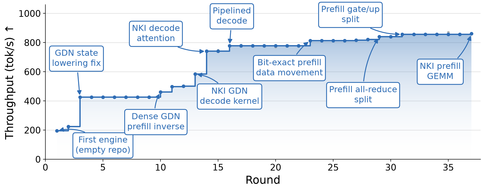
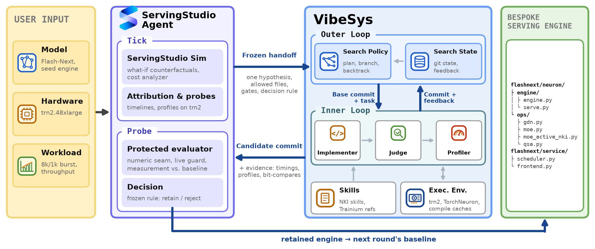
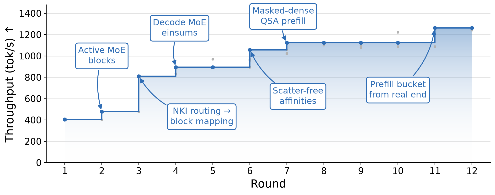

**TL;DR:** We ran [VibeSys](https://github.com/uw-syfi/vibesys), our multi-agent system for building systems, to generate serving engines for two new hybrid Qwen3.8 models on AWS Trainium2. The serving ecosystem is thin on this hardware, and no open-source systems support these models. On one Trainium2 chip, agents wrote a Qwen3.8-27B engine and raised it from 195 to **861 tok/s**, starting from a basic PyTorch implementation. On a 16-chip node, VibeSys guided by [ServingStudio](https://syfi.cs.washington.edu/blog/2026-09-24-introducing-servingstudio) made a Qwen3.8-Flash-Next engine **3.1×** faster. This shows the potential of an agent-driven approach to push the frontier of what can be served well, even where no strong open-source ecosystem exists.

***Figure 1.** VibeSys run for Qwen3.8-27B on one trn2.3xlarge.*

## A long-tail target

In the [VibeServe paper](https://arxiv.org/abs/2605.06068), we laid out a vision for agent-driven bespoke systems. Generic serving engines do well on common cases but miss optimization opportunities on the long tail. For that tail, coding agents make it affordable to generate a bespoke engine per target. Our [AMD MI300A post](https://syfi.cs.washington.edu/blog/2026-10-08-qwen35-mi300a) tested this thesis on AMD GPUs.

We now extend the scope to AWS Trainium2, targeting Qwen3.8 models (Qwen3.8-27B and Qwen3.8-Flash-Next). Trainium2 is an even harder target because of its different programming model and thinner open-source support. On Trainium, the recommended serving path is [vLLM Neuron](https://awsdocs-neuron.readthedocs-hosted.com/en/latest/vllm-neuron/docs/index.html), with its [model recipes](https://awsdocs-neuron.readthedocs-hosted.com/en/latest/vllm-neuron/docs/model-recipes/index.html) covering only Llama 3, gpt-oss, dense Qwen3-32B, and a few other Qwen3 variants, not supporting Qwen3.8 models.

Porting inference engines written for other hardware also doesn't work. Trainium's compiler needs static shapes and decides memory layouts itself, and its NeuronCores are programmed through [NKI](https://awsdocs-neuron.readthedocs-hosted.com/), not CUDA.

Qwen3.8's architecture makes the serving system even harder to implement. Both models interleave Gated DeltaNet linear attention, which keeps a recurrent state per sequence, with gated full attention. Flash-Next adds QSA sparse attention with a learned indexer, a 512-expert MoE, hyper-connections, an n-gram embedding table, and an MTP draft layer. Each mechanism needs its own state, routing, or kernels.

Together, these models and this hardware form a combination that generic systems have not reached. This is exactly the kind of target where a bespoke system has the most to gain.

## Supporting Trainium in VibeSys

We use [TorchNeuron](https://awsdocs-neuron.readthedocs-hosted.com/en/latest/release-notes/components/torchneuron.html), the native PyTorch backend that AWS released in October. It exposes Trainium2 as a `neuron` device. Code runs either in eager mode, where each operation is compiled the first time it sees a new shape, or through `torch.compile(backend="neuron")`, which compiles a whole captured graph into one executable with `neuronx-cc`. NKI kernels are called from PyTorch as custom operators.

To support Trainium in VibeSys, we modified the framework to provide three things:

- **Hardware access.** Every agent and every trusted evaluation runs in AWS's TorchNeuron container, with the Trainium devices passed in. Compiling a graph shape takes minutes, so compile caches persist across containers and rounds.
- **Knowledge.** Agents get AWS's [NKI skills](https://github.com/aws-neuron/neuron-agentic-development) for writing, debugging, and profiling kernels. They also get our own references for serving on Trainium.
- **Profiling.** The profiler agent, and any other agent that needs it, gets a wrapper around AWS's `neuron-explorer` profiler. It shows where device time goes, down to individual engine instructions.

## Experiment 1: Qwen3.8-27B from scratch on one chip (`trn2.3xlarge`)

**Setup.** [Qwen3.8-27B](https://huggingface.co/Qwen/Qwen3.8-27B) has 64 layers (48 GDN, 16 attention) and 54 GB of BF16 weights. Serving it requires sharding the model across all four NeuronCores of a `trn2.3xlarge`, which has one Trainium2 chip and 96 GiB of HBM. The workload is 64 concurrent requests of 1k prompt tokens and 1k generated tokens, and the metric is output throughput.

The starting point is the Hugging Face Transformers implementation of the model, which is generic PyTorch code that also serves as the correctness reference but has few serving optimizations and nothing written for Trainium. From it, agents wrote the whole engine in a fresh repository, including the model layers in PyTorch and NKI, the scheduler, the caches, and the HTTP server. Existing serving engines and model libraries such as vLLM Neuron and NxD Inference were off limits. Every round had to pass an accuracy gate that compares greedy outputs and teacher-forced logprobs against Transformers on 12 prompts, including 4k-token and cache-resume cases. A candidate was accepted only if it beat the current best by more than the 2% noise bar.

All agents ran on Opus 5.5. The 37 rounds took about 53 hours and $230 in API usage.

**Results.** The first working engine served 195 tok/s, 50 minutes in. By round 3, it served 425 tok/s, and the final engine (round 37) serves **860.7 tok/s** (Figure 1). That cut the benchmark's wall time from 336 s to 76 s. A decode step for 64 sequences now takes 56 ms, down from 111 ms after round 3. The final engine is about 2,400 lines of Python, including three NKI kernels.

### Where the speedup came from

**Fix the compiler's state updates (224 → 425 tok/s).** In round 3, the agents found that an indexed copy of one slot's GDN state was slower than a dense masked `where` over all 64 slots (57 vs. 19 ms per prefill layer group). A one-pass decode recurrence also cut a decode layer group from 10.4 to 6.7 ms.

**Stop moving the GDN state (425 → 584 tok/s).** Decode moved about 1.1 GB of FP32 state per layer group, almost four times the minimum. A dense prefill inverse, double-buffered state, and a single-pass NKI decode kernel fixed this. The agents wrote the kernel by following the compiler's instruction stream, so its output is **bit-identical**. VibeSys's accuracy gate caught an earlier, faster but buggy kernel that flipped a near-tie token.

**Stop re-laying out memory (584 → 778 tok/s).** Compiled decode attention spent about 1.0 ms transposing the KV cache before 0.25 ms of real work, so a hand-written NKI attention kernel gave **+27%**. Pipelining decode with a non-blocking copy and an event wait, instead of `.cpu()`, which waits for the whole device queue, saved another 4 ms per step.

**Trim prefill (778 → 861 tok/s).** Smaller changes added 0.3–5% each.

- bit-exact slot writes;
- decode inputs kept on the device;
- split MLP projections and all-reduces;
- an NKI GEMM for the GDN input projection.

## Experiment 2: Qwen3.8-Flash-Next on 16 chips, guided by ServingStudio (`trn2.48xlarge`)

**Setup.** We serve Qwen3.8-Flash-Next (48 layers, BF16) on a `trn2.48xlarge` with 16 Trainium2 chips. We optimize throughput for a burst of 64 requests of 8k input and 1k output tokens.

Running and debugging many experiments at this scale, with a 48-layer MoE model across 16 chips, is extremely time-consuming, and a single new kernel's warmup can take close to an hour. So we started by supporting the model in ServingStudio, our in-house simulator for LLM serving systems ([PR](https://github.com/SyFI-ServingStudio/ServingStudioSim/pull/107)). That work had four parts.

- writing a simple TorchNeuron engine, a sharded port of the model's plain-PyTorch reference code with a minimal scheduler;
- profiling its operators on Trainium2;
- adding the architecture and its Trainium2 knobs (parallelism, MoE dispatch, shape buckets, MTP) to the simulator;
- aligning the simulator with the real engine, to a median error of 6% over 16 serving runs.

With the simulator, agents could rank changes before spending hours on hardware.

***Figure 2.** The VibeServe architecture, extended with a ServingStudio Agent that hands VibeSys one hypothesis per round and decides on the result.*

**The loop.** Each round is one Tick → Tock → Probe cycle (Figure 2).

1. **Tick.** The ServingStudio agent profiles where time goes in the current engine, and finds the biggest bottleneck, using the simulator and sometimes a quick test on the hardware. It then writes a handoff, a document for VibeSys that describes one change and why it should help, which files may change, which tests the result must pass, and which measurement will decide whether to keep it.
2. **Tock.** A fresh VibeSys run implements the handoff.
3. **Probe.** A protected evaluator checks the candidate and measures it against matched baseline runs. The agent then retains or rejects the candidate according to the frozen rule.

**Results.** In 12 rounds (11 retained, 1 rejected), throughput rose from 404 to over **1,240 tok/s (3.1×)** (Figure 3). The 12 rounds took 18 VibeSys runs over about four days and roughly $800 in API usage, about $300 of it in VibeSys runs and the rest in the ServingStudio agent.

***Figure 3.** VibeSys run for Qwen3.8-Flash-Next on one trn2.48xlarge.*

| Round | Change (one bottleneck per round) | Key result |
|:--|:--|:--|
| 2 | Run only the active prefill MoE expert blocks | +19% throughput |
| 3 | Prefill MoE routing → block mapping on device (NKI), bit-identical | **+70% throughput** |
| 4 | Decode MoE as expert-layout einsums | +7%; time per output token −20% |
| 5 | Scatter-free decode affinities, bitwise gate | **rejected** (20 of 28 cases bit-identical) |
| 6 | Same change, tolerance gate | time per output token −6% |
| 7–8 | QSA prefill as exact masked-dense attention | time to first token −20% |
| 9 | Balanced static expert placement | time to first token −8% |
| 11 | Prefill context bucket from the chunk's real end | time to first token −5% |

**Picking the bottleneck.** The largest gain came early. The round-3 Tick showed that preparing the MoE routing → block mapping took 16.1 of the 18.1 ms of routed-expert time on the slowest rank. That is bookkeeping, not expert math. Moving it onto the device with `nkilib` kernels kept outputs bit-identical and raised throughput by 70%.

Later Ticks found subtler waste. In round 9, MoE prefill work was unevenly spread across ranks, and a balanced static expert placement fixed it. In round 11, a padding choice in the engine ran the final prefill chunks at a 16k context bucket. The simulator does not model that choice, so a quick hardware test found it.

Predictions were often close to the measurements. In round 2, the simulator counterfactual predicted 479.0 tok/s against 478.8 measured. In round 11, a quick hardware test predicted a time-to-first-token change of −5.6% against −5.2% measured.

## Try it

VibeSys is available at [github.com/uw-syfi/vibesys](https://github.com/uw-syfi/vibesys), and the [paper](https://arxiv.org/abs/2605.06068) describes its design. ServingStudio is at [github.com/SyFI-ServingStudio/ServingStudio](https://github.com/SyFI-ServingStudio/ServingStudio).

The full records of both experiments, including code, per-round evidence, framework event logs, and agent transcripts, are available at [github.com/vibesys-playground/qwen3.8-trainium2-vibesys](https://github.com/vibesys-playground/qwen3.8-trainium2-vibesys).

## Acknowledgements

We thank AWS for providing the compute credits that made these experiments possible.
