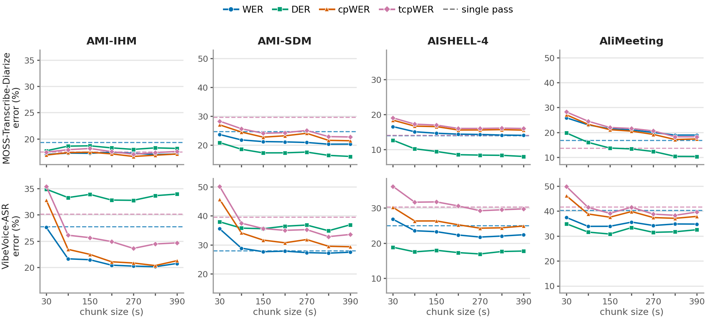
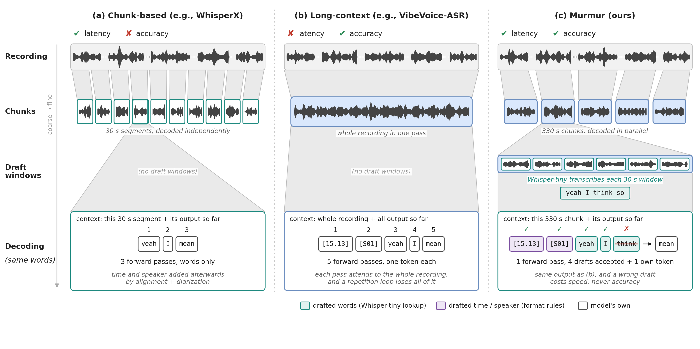
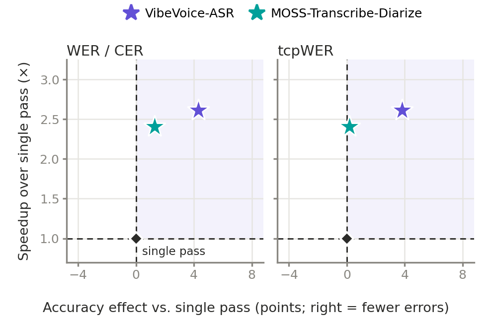

**TL;DR:** Murmur speeds up long-context ASR models on audio up to 1 hour by 2.5× on average (up to 2.9×), end to end including diarization. It also lowers speaker-attributed error (tcpWER) compared with WhisperX by 7-17 points on English meetings and 10-51 points on Mandarin.

- 📄 preprint: [https://arxiv.org/abs/2606.01483](https://arxiv.org/abs/2606.01483)
- 💻 code: [https://github.com/uw-syfi/Murmur](https://github.com/uw-syfi/Murmur)

<video controls width="100%" style="max-height: 640px;">
  <source src="/assets/img/blog/2026-11-13-murmur/murmur_demo.mp4" type="video/mp4">
  Your browser does not support the video tag.
</video>

*Single pass, Murmur, and WhisperX transcribing the same 32-minute AMI meeting on one H100, replayed at 8×.*

---

## Motivation

Recent long-context ASR models, such as Microsoft VibeVoice-ASR and MOSS-Transcribe-Diarize, process an hour or more of audio in a single pass. They generate text, timestamps and speaker labels at the same time. An hour of audio is tens of thousands of audio tokens (about 27,000 for VibeVoice-ASR), so a single pass is slow: on one H100, VibeVoice-ASR takes about 2.5 minutes to transcribe a 44-minute meeting. These models can also fall into a repetition loop, which makes the whole request fail.

The other common approach is to split the recording into short chunks, such as the 30 s chunks WhisperX uses for Whisper. Timestamps and speaker labels then have to be stitched together across hundreds of chunk boundaries, which lowers accuracy, especially in speaker attribution. This design was built for short-context models, while long-context models can take in minutes of audio at once.

Neither option fits long-context models well. We revisit how long audio should be chunked and served for these models, and design Murmur, an inference system that closes the gap between the two approaches.

## Observations

We first study how chunk size affects long-context ASR. Across 4 datasets and 2 languages (English and Mandarin), error drops quickly as chunks grow from 30 s and levels off within a few minutes (Figure 1). At 330 s, chunked decoding already improves on or matches single pass on word error rate (WER) and time-constrained word error rate (tcpWER) in most cases, so the model does not need the whole recording in one pass.



***Figure 1.** Error vs. chunk size (30-390 s) for MOSS-Transcribe-Diarize and VibeVoice-ASR on four meeting datasets. Dashed lines are single pass. Error drops quickly from 30 s and levels off by about 150-330 s, mostly on the speaker metrics (cpWER, tcpWER).*

Two more observations shape the design:

1. **Short chunks still get the words right.** WER changes little with chunk size, so even 30 s windows transcribe most words correctly.
2. **What short chunks lose is speakers and timestamps.** The extra error at small chunk sizes comes from linking speakers and timestamps across chunks. For VibeVoice-ASR on AMI-IHM, cpWER is 32.8 at 30 s and 20.4 at 330 s.

## Murmur

Murmur splits a recording at two levels (Figure 2).



***Figure 2.** (a) WhisperX decodes 30 s segments independently and adds timestamps and speakers afterwards. (b) Long-context models decode the whole recording in one pass. (c) Murmur decodes ~5-minute chunks in parallel, and a small model's transcript of 30 s windows drafts tokens that the long-context model verifies.*

- **Target chunks (~5 minutes).** The long-context model decodes ~5-minute chunks in parallel, which gives most of the speedup. It still writes its own timestamps and speaker labels within each chunk, and a repetition loop costs at most one chunk instead of the whole recording.
- **Draft windows (30 s).** A lightweight ASR model (Whisper-tiny for English, Whisper-small for Mandarin) transcribes each 30 s window, and its words become draft tokens for speculative decoding. Simple format rules draft the timestamps and speaker tags. The long-context model verifies every draft token, so the output is exactly what it would generate without drafts.

Drafts help most when each decoding step is expensive. For VibeVoice-ASR, with its 7B decoder, they add 1.1-1.8× on top of chunking. For MOSS-Transcribe-Diarize, with a 0.6B decoder, each step is already cheap, so Murmur uses target chunks alone.

## Results

Latency per recording, including diarization, and tcpWER (lower is better for both), on one H100 with vLLM. Each cell is tcpWER / latency.

| Model | System | AMI-IHM | AMI-SDM | AliMeeting | AISHELL-4 |
|---|---|---|---|---|---|
| Whisper large-v3 | WhisperX | 31.9% / 36 s | 39.6% / 35 s | 68.6% / 36 s | 40.5% / 42 s |
| VibeVoice-ASR | single pass | 30.1% / 109 s | 39.6% / 100 s | 41.7% / 123 s | **30.3%** / 111 s |
| | **Murmur** | **24.5% / 38 s** | **32.9% / 39 s** | **38.7% / 47 s** | 30.5% / **46 s** |
| MOSS-Transcribe-Diarize | single pass | 17.5% / 54 s | 29.6% / 77 s | **13.6%** / 91 s | **14.1%** / 51 s |
| | **Murmur** | **17.3% / 26 s** | **22.8% / 26 s** | 17.5% / **32 s** | 16.6% / **26 s** |



***Figure 3.** Speedup over single pass vs. change in error (points, right = fewer errors), averaged over the four datasets.*

- **Speed:** Murmur is 2.0-2.9× faster than single pass on every model and dataset. With MOSS-Transcribe-Diarize it is also faster than WhisperX. With VibeVoice-ASR it takes about the same time as WhisperX on English meetings.
- **Accuracy:** Murmur has lower tcpWER than WhisperX on every dataset, and lower than single pass in 5 of 8 cases.
- **Where single pass still wins:** MOSS-Transcribe-Diarize on Mandarin. Its single pass keeps all speakers in one context and stays 2.5-3.9 points ahead on tcpWER. VibeVoice-ASR's single pass is also 0.2 points ahead on AISHELL-4.

## How to use Murmur

```python
from murmur import Murmur

with Murmur.load("vibevoice") as m:      # or "moss"
    t = m.transcribe("meeting.wav")
    print(t)                              # [  12.40-  15.10] SPEAKER_01: ...
```

Murmur runs the model on vLLM and uses pyannote for diarization. The repo has the install steps for each model and benchmark scripts for all four datasets.

## Conclusion

Murmur closes the gap between the two current approaches to long-audio ASR. Across chunks, we find that an intermediate chunk size of about 5 minutes gives long-context models enough context, so Murmur decodes these chunks in parallel. Within each chunk, Murmur uses hierarchical chunking: a small ASR model transcribes 30 s draft windows, and speculative decoding turns its words into drafts that the long-context model verifies, so decoding is faster and the output is unchanged. Together, Murmur makes long-context ASR 2.5× faster than single pass on average, with lower speaker-attributed error than WhisperX on every dataset we tested.
