**TL;DR:** How good are coding agents at building inference systems *from scratch*? We introduce Humanity's Last System (HLS), an ultra-long-horizon agentic coding benchmark that gives frontier agents live GPU sandboxes with up to 8xH200s and up to 36 hours to build systems hyperspecialized to a model, hardware platform, and production workload. HLS introduces a token-level verifier that checks a submission against a trusted reference while allowing the numerical variation that occurs in real serving systems. We evaluate frontier proprietary and open models across text and multimodal inference tasks using production workloads. **The top-performing agent, Opus 5, outperforms the baseline in 71% of runs and achieves impressive speedups in some runs.** The rest trails far behind: no other agent beats the baseline in more than 24% of runs. We release the evaluation framework and over [150 trajectories](https://hlsbench.com/traces), comprising over *238,000 steps*, to support analysis of how agents develop hyperspecialized systems and how they could develop them better.

<picture><source media="(max-width: 600px)" srcset="/assets/img/blog/2026-11-20-introducing-hls/framework-narrow.png">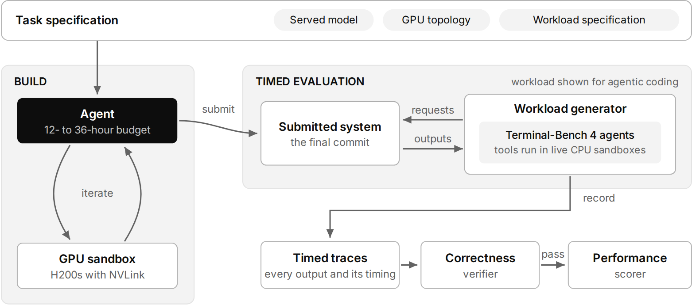</picture>

***Figure 1. The HLS framework.** An agent receives the task specification and builds a serving system in a GPU sandbox. Its final commit is deployed in a fresh container and serves the task's timed workload, shown here with agentic coding's generator, whose Terminal-Bench 4 agents run their tools in live sandboxes. The outputs and timings recorded during that one run are used for both verification and scoring; a server that fails verification scores zero.*

## Background

Frontier models are increasingly heterogeneous in their architectures, from sparse attention to recurrent states, which complicates maintaining a generic abstraction and day-0 support for newly released models. Generality can leave performance on the table, and building optimized generic serving systems requires substantial expert effort. Coding agents could reduce this engineering burden by building systems hyperspecialized to a model, hardware platform, and workload. Our previous work, VibeServe ([Kamahori et al., 2026](https://arxiv.org/abs/2605.06068)), demonstrated this possibility: agents generated hyperspecialized serving systems that outperformed existing engines in several settings. These results motivate studying agents' ability to carry out the systems engineering needed for such hyperspecialization.

Building these systems is an ultra-long-horizon coding problem: kernels, memory management, scheduling, and parallelism must be designed, integrated, profiled, and tested together over many hours. Many existing coding benchmarks focus on isolated kernels or incremental patches to existing codebases, leaving this end-to-end engineering process less directly tested. The challenge of HLS is for agents to sustain this development process to build fast, correct, hyperspecialized stacks from scratch.

HLS provides this evaluation framework together with traces from our rollouts. Across the 153 rollouts, **the median trajectory spans 1,213 steps and 826,000 tokens, with the longest trajectory reaching 4.14 million tokens**. The trajectories link agents' experiments, errors, and design changes to their implementations and evaluation outcomes, enabling analysis of how they develop a serving system over many hours.

## HLS

### Tasks

Our tasks cover text, agentic, and multimodal serving using production workloads and traces on one to eight H200s over NVLink. Concurrent traffic and multi-turn sessions exercise scheduling and cache management in ways that a fixed batch of uniform requests can miss. The model architectures span dense Transformers, MoE, and hybrid models.

Case study: the challenge of serving GLM-5.3-Flash

In the agentic-coding task, we ask the agent to create an inference stack for **GLM-5.3-Flash on 8xH200s** with support for contexts up to **1M tokens** using [Terminal-Bench 4](https://www.tbench.ai/?version=4.0) ([Merrill et al., 2026](https://arxiv.org/abs/2601.11868)) problems as the workload. Prefix reuse is particularly challenging because GLM-5.3-Flash combines the attention cache of DeepSeek Sparse Attention (DSA) with the mutable recurrent state of Kimi Delta Attention (KDA). KDA updates its recurrent state in place at every token. Consequently, a cached state at length *L* cannot be reused for a shorter matching prefix, and that prefix must be recomputed from scratch. The agent must decide which prefix boundaries to checkpoint, which snapshots to retain while sessions wait for tools, and when to evict them. More snapshots can reduce recomputation, but leave less memory for attention caches and active requests.

These decisions interact with how the model is parallelized across the 8 GPUs: prefill–decode disaggregation, and tensor, expert, and context parallelism for prefill and decode. Tensor and expert parallelism (TP+EP) distributes computation and experts but replicates DSA's state, while tensor and decode context parallelism (TP+DCP) partitions the attention cache at a higher communication cost. Each layout leaves a different memory and communication budget for cached states and active sessions. The agent must therefore choose parallelism and checkpointing policies together, under a workload whose context lengths, prefix reuse, and active sessions change as Terminal-Bench agents (the workload) execute tools.

### Verifiers

A natural way to check an optimized serving system is to measure how well its outputs perform on a downstream task. For a speech-recognition (ASR) model, transcription accuracy may be exactly what matters; for a general-purpose language model, passing one task says little about behavior on others. HLS therefore supports two approaches: task-level metrics for a specified downstream use, and token-level verification to test whether a server preserves the reference model's output distribution.

The choice determines which optimizations are acceptable. Agents can optimize aggressively for a task-level metric, so the task-level verifier must fully cover the intended downstream workload. In our speech-recognition task, an Opus 5 submission shortened Whisper's zero-padded encoder window. This changed some transcripts but stayed within the transcription-accuracy tolerance: an acceptable tradeoff for the evaluated workload, even though the outputs were no longer token-equivalent to the reference.

For general-purpose text serving, downstream evaluations can be too narrow, noisy, or expensive to establish that model behavior is preserved. Our token-level verifier instead checks the tokens emitted under the timed workload by teacher-forcing the reference on the submission's trajectories. This exposes the verifier to the same concurrency, cache reuse, and context lengths that determine serving performance. Exact agreement is too strict a test because of batch nondeterminism and differences between kernel implementations. Too tolerant a margin, on the other hand, would accept servers whose errors degrade the model. HLS calibrates its tolerances from trusted implementations, including vLLM, SGLang, and vLLM-Omni, serving the task's workload.

<picture><source media="(max-width: 600px)" srcset="/assets/img/blog/2026-11-20-introducing-hls/verifier-comparison-narrow.png">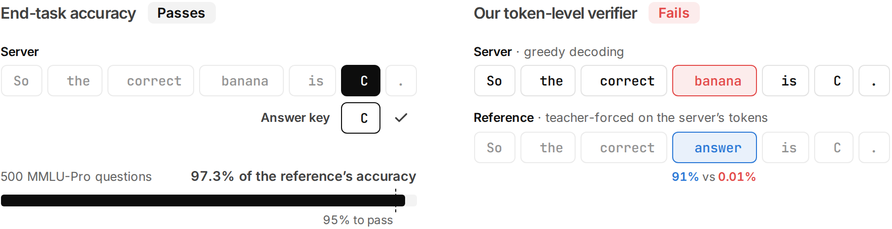</picture>

***Figure 2. End-task accuracy misses real system defects.** Our token-level verifier compares the output distribution at every token with a trusted reference implementation while tolerating numerical variation seen with kernel implementation choices and batch nondeterminism in serving. End-task accuracy compares only the answer with the answer key and misses many defective servers seen in our rollouts.*

### Scoring

HLS scores a system by how quickly it serves the task's workload relative to a production-engine baseline on the same hardware; a submission that fails correctness receives zero. For vLLM baselines, we use the shipped defaults without additional tuning, except for agentic coding, where we set tensor parallelism to eight (`tp=8`) and expert parallelism to eight (`ep=8`). For streaming tasks, we measure time to first token (TTFT) and time per output token (TPOT). We divide each by its corresponding service-level objective (SLO) and take the larger ratio. Thus, each request is judged by whichever latency is worse relative to its target. For non-streaming tasks, we measure job completion time (JCT). We take the geometric mean over requests or trajectories and normalize by the baseline: 1× matches the baseline, and scores above 1× indicate an improvement. A server must sustain the specified traffic, so queueing and delays decrease its score.

### Evaluation environment

Agents work in containers on NVIDIA HGX H200 systems with compilers, profilers, model checkpoints, and development data provided. The test split that the agent is graded on is held out. General internet access is disabled, but agents may install packages with pip, except for high-level inference frameworks and optimized kernel libraries. Their final committed implementation is frozen and deployed into a fresh container for evaluation ([Figure 1](#figure-framework)).

## Results

Coding agents can build serving systems that outperform production engines, but success varies substantially across tasks and attempts. Opus 5 produces correct systems in 81% of runs and beats the baseline in 71%, achieving the highest maximum speedup on six of the seven tasks ([Figure 3](#figure-leaderboard)). Its strongest results include 25.87× on speech recognition, 4.92× on omni chat, and 2.40× on speech synthesis. It still fails to produce correct systems consistently across all tasks, making correctness verification essential when evaluating an agent's claimed speedups.

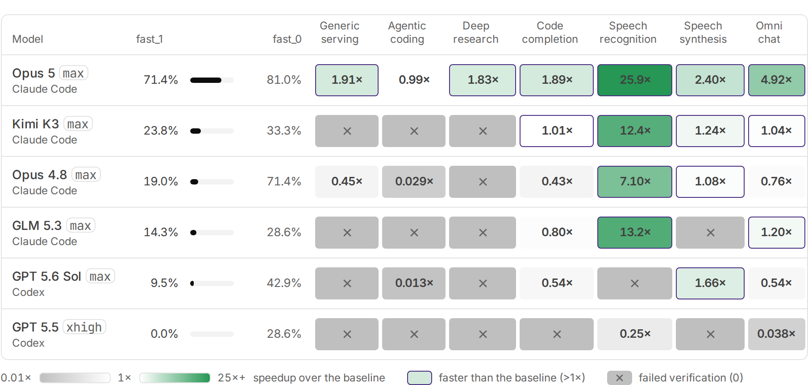

***Figure 3. Leaderboard.** Each task column shows a model's best speedup over the production baseline among its three 12-hour runs; 1× matches the baseline, a purple border marks a speedup above 1×, and a gray ✗ means no run passed verification. Following KernelBench ([Ouyang et al., ICML 2025](https://proceedings.mlr.press/v267/ouyang25a.html)), we define `fast_p` as the share of runs that pass verification and achieve a speedup greater than `p`. `fast_0` is the share of runs that pass verification, and `fast_1` is the share that pass verification and beat the production baseline. On [hlsbench.com](https://hlsbench.com), each cell opens the run's full trajectory and source.*

To understand the differences between agents, we also examined how they used the same 12-hour development budget. Opus 5 runs averaged 2% idle time and typically continued testing after their last code edit, which came at a median of 9.6 hours. Opus 4.8 runs averaged 25% idle time, with a median last code edit at 6.2 hours. GPT 5.6 Sol, Kimi K3, and GLM 5.3 generally edited until the final one to two hours; their lower passing rates therefore cannot generally be explained by stopping early. New measurements dominated every model's time; repeats on unchanged code averaged only half an hour ([Figure 4](#figure-activity)).

<picture><source media="(max-width: 600px)" srcset="/assets/img/blog/2026-11-20-introducing-hls/activity-narrow.png">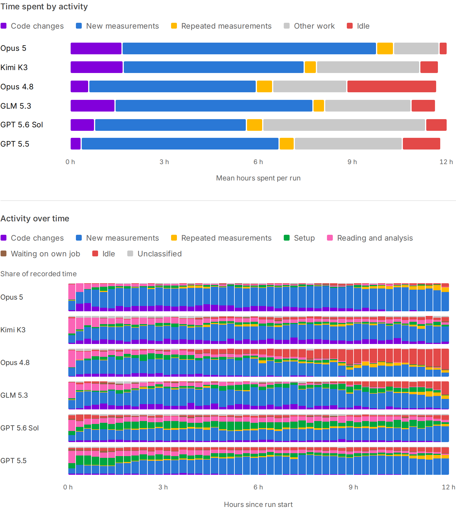</picture>

<picture><source media="(max-width: 600px)" srcset="/assets/img/blog/2026-11-20-introducing-hls/activity-by-run-narrow.png">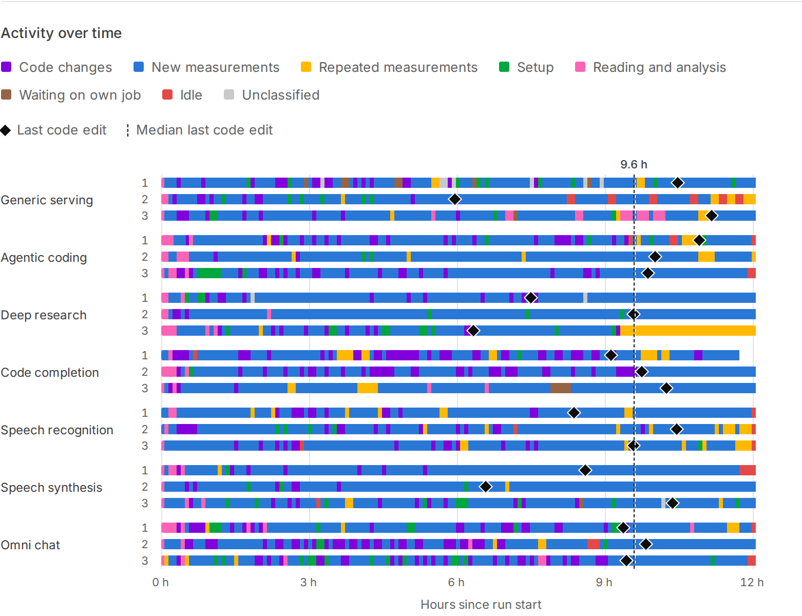</picture>

***Figure 4. Run activity and last code edits.** The upper panel shows average hours spent per activity across each model's 21 main-evaluation runs. New measurements test changed code or a changed condition; repeated measurements rerun an unchanged test. Other work is setup, reading and analysis, waiting on the agent's own jobs, and unclassified time. Idle means none of the agent's jobs was running. A bar falls short of 12 hours when runs ended early. The middle panel shows how activity changes over time: each bar stacks the share of recorded time spent on each activity across a model's runs in a 15-minute interval. The bottom panel shows Opus 5's 21 runs, each strip the predominant activity in each five-minute interval; diamonds mark the last code edit in each run, and the dashed line marks the median.*

Across all agents, 48% of runs pass correctness and 23% exceed the baseline. Agentic coding remains the hardest task: only 33% of runs pass, and the best reaches 0.985×. At 24 hours, all five Opus 5 runs pass and beat the baseline on generic serving. Their geometric mean speedup is 1.97×, up from 1.46× among the two passing runs at 12 hours. Extending the budget to 36 hours raises the geometric mean speedup among passing runs to 2.24×, a 14% gain, while mean cost per attempt rises 36%, from \$664 to \$900 ([Figure 5](#figure-budget)). One of the five 36-hour runs fails. The longer budget improves the performance of passing runs, while 24 hours yields more above-baseline systems in these repeats.

<picture><source media="(max-width: 600px)" srcset="/assets/img/blog/2026-11-20-introducing-hls/budget-narrow.png">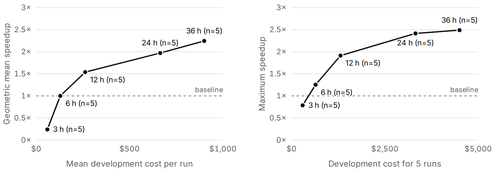</picture>

***Figure 5. Speedup versus development cost.** Both panels vary the time budget for Opus 5 on generic serving at Max effort. The first plots geometric mean speedup among runs with nonzero scores against mean development cost per run. The second plots the maximum observed speedup against five times the mean development cost per run. Both cost measures include API tokens and GPU time across all runs, including failures. Labels show the number of runs, and dashed lines mark the production baseline.*

Opus 5 costs more per run than Kimi K3 (\$402 versus \$254), but its higher rate of correct, above-baseline systems (71% versus 24%) more than offsets that difference ([Figure 6](#figure-cost)). Dividing total development spending by the number of such systems gives about \$560 per result for Opus 5 and \$1,070 for Kimi K3 across the same task mix. A stronger, more expensive agent can therefore be the more economical choice once failed and below-baseline attempts are included. Opus 4.8 costs roughly as much per attempt as Opus 5 (\$418), yet beats the baseline in only 19% of runs; GPT 5.5 averages \$273 and does so in none. These estimates cover development; evaluation costs are excluded.

<picture><source media="(max-width: 600px)" srcset="/assets/img/blog/2026-11-20-introducing-hls/cost-narrow.png">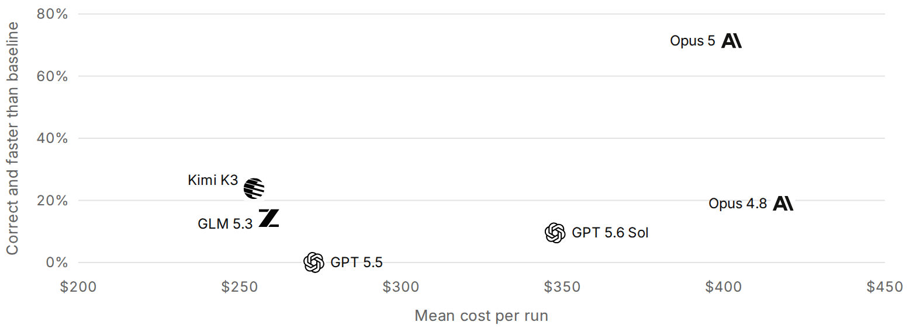</picture>

***Figure 6. Cost and success by model.** Each point is one model over its 21 main-evaluation runs: seven tasks, three 12-hour runs each. The horizontal axis is the mean cost of a run, API tokens plus the run's reserved H200s at \$5.97 per GPU-hour; the vertical axis is the share of runs that passed verification and beat the baseline. Evaluation costs are not included.*

### Where the speedups come from

Better prefix reuse and speculative decoding let the generic-serving and deep-research submissions beat vLLM despite slower underlying engines. In generic serving, vLLM's shared memory pool for attention and recurrent state restricts prefix reuse to coarse boundaries. The Opus 5 submission checkpoints recurrent state more finely, increasing the reused share of prompt tokens from 19% to 39%. It also enables the model's multi-token prediction head for speculation. Together, these changes take the system from 0.92× to 1.91× baseline performance ([Figure 7](#figure-ablation)).

<picture><source media="(max-width: 600px)" srcset="/assets/img/blog/2026-11-20-introducing-hls/ablation-narrow.png">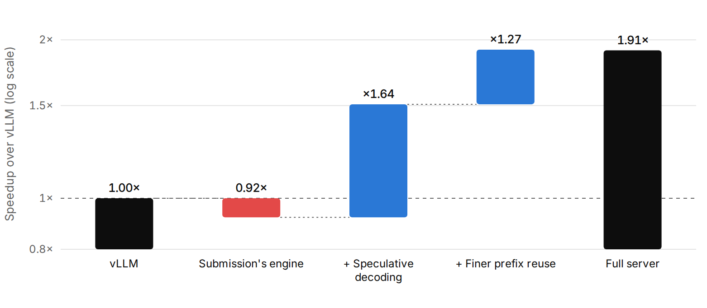</picture>

***Figure 7. Generic-serving speedup breakdown.** The best Opus 5 generic-serving server against vLLM. With speculation and its prefix reuse disabled, the submission's engine runs at 0.92× vLLM's speed; speculative decoding and finer-grained prefix reuse multiply that by 1.64 and 1.27, reaching the graded 1.91×. Each factor was measured by disabling its mechanism on the full workload, averaged over both orders of adding the two.*

Reducing CPU dispatch overhead offered another large gain, especially under concurrent arrivals. In speech recognition, admitting new audio forced the baseline decoder out of CUDA graphs ([Figure 8](#figure-asr-step)). The submission captured admission and decoding separately; disabling either capture increased reply latency about 4.3×. This exposes a limitation of optimizing decode in isolation: an efficient decode path can still be interrupted by expensive request admission. Under the task's traffic, those interruptions slowed active requests and increased queueing, magnifying the end-to-end benefit of graph capture.

<picture><source media="(max-width: 600px)" srcset="/assets/img/blog/2026-11-20-introducing-hls/asr-step-narrow.png">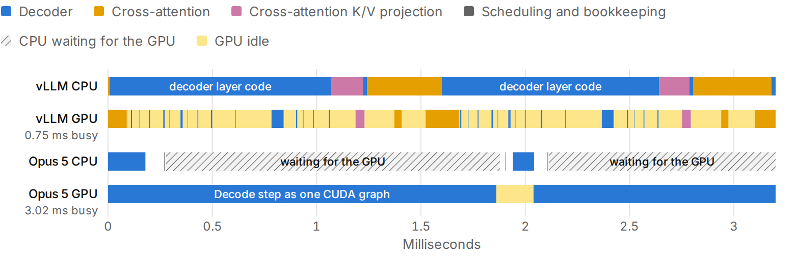</picture>

***Figure 8. Speech-recognition decoder timelines.** A 3.2 ms window of decoding in each speech-recognition server at 52 requests per second, profiled with Nsight Systems. vLLM launches decoder kernels one at a time from the CPU. The Opus 5 submission launches a full decode step as a single CUDA graph of 326 kernels.*

Faster kernels alone do not establish a faster inference system: prefix caching and speculation change how much computation is needed, while scheduling and CUDA-graph execution determine when that computation runs and how long the GPU waits on the CPU. Kernel-level benchmarks miss these serving effects, but HLS tests these components together under concurrent traffic, where an optimization must improve end-to-end serving performance.

### How agents build and where they fail

The trajectories expose a mismatch between where performance gains arise and how agents search for them. Agents often tune parameters within an early architectural choice, evaluate with a workload that makes their server look better than it is, or stop investigating an error before checking its scope. We reviewed 153 runs, including time- and effort-budget ablations, and 1,680 performance decisions in the 81 runs that passed correctness.

### Finding 1: Agents make major design decisions early and rarely profile alternatives.

The first design decision in a run is the serving engine itself: whether to write the model's forward pass, decode loop, and request scheduler from scratch, or to build the server around a library path such as `transformers.generate`. Agents made this decision at a median of 13 minutes, mostly by reasoning from the task description or by default. Only 8% of these decisions compared the options by measurement, and in 84% of cases the chosen approach was already present in the first working server ([Figure 9](#figure-decisions)). The choice determines which requests can make progress together: an engine with its own loop can admit new requests while others are still generating, whereas a server built on `generate` runs each batch to completion. This lack of comparison concerns consequential decisions: in 78% of passing runs, the single largest improvement in the agent's own benchmarks came from scheduling, batching, speculation, state reuse, GPU layout, or graph capture.

Across all performance decisions, the faster and slower halves of passing runs within each task measured alternatives at similar rates: 35% and 38%. Faster runs tested mechanisms such as continuous batching or speculative decoding; slower runs often adjusted batch caps, wait windows, and chunk sizes within an unchanged engine. This suggests that choosing more consequential experiments could matter more than simply running more of them. Requiring an early comparison of viable batching, execution, or GPU-placement strategies could keep agents from spending most of the budget tuning a poor initial choice.

<picture><source media="(max-width: 600px)" srcset="/assets/img/blog/2026-11-20-introducing-hls/decisions-narrow.png">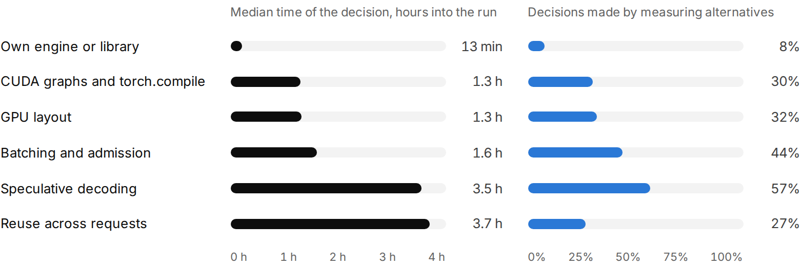</picture>

***Figure 9. Timing and testing of design decisions.** The 1,680 performance decisions in the 81 runs that passed verification, by kind. Left: the median time of the decision, from the start of the run. Right: the share of decisions made by measuring alternatives against each other. The choice between writing an engine and building on a library, made first, was almost never measured.*

Reducing CPU dispatch overhead also required agents to work through execution failures. An Opus 4.8 agentic-coding run found that graph breaks and recompilation made its `torch.compile` forward pass slower than eager PyTorch. A GPT 5.6 Sol run hit unsupported convolution-cache mutation in `torch.compile`'s CUDA-graph mode, then abandoned a second attempt after ten minutes of compilation. A Kimi K3 omni run measured a 2.73× speedup over its previous decode path with `torch.compile`, but discarded the change after a hang without identifying the cause. These attempts exposed integration problems that the agents did not resolve into a working compiled path. In the two agentic-coding runs, CPU dispatch remained a bottleneck.

### Finding 2: Agents that built correct, faster systems estimated their speedups more accurately.

We compared self-estimated and graded speedups in 99 of 126 main runs. In the other runs, the agent never ran a comparable benchmark or the submission failed before producing a timing result. The median ratio of self-estimated to graded speedup was 1.07 for correct systems above baseline, 1.76 for correct systems below it, and 4.18 for failed systems ([Figure 10](#figure-self-estimate)). Slower and failed runs thus tended to look substantially better in the agent's tests than under evaluation. For failed systems, the graded speedup is the grader's timing bound before the zero-score penalty.

<picture><source media="(max-width: 600px)" srcset="/assets/img/blog/2026-11-20-introducing-hls/self-estimate-narrow.png">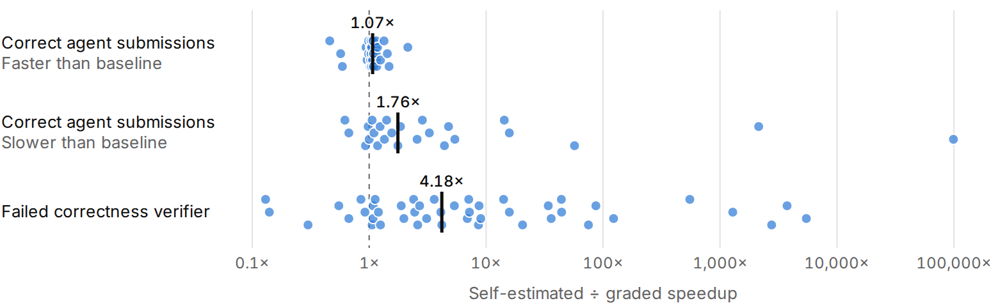</picture>

***Figure 10. Self-estimated versus graded speedup.** Each point shows the estimated speedup divided by the graded speedup for one of the 99 runs with comparable measurements. The horizontal axis uses a log scale, and points right of 1× overestimate speedup. Vertical bars mark each group's median. For failed runs, the graded speedup is the grader's timing bound before the zero score.*

Short tests hid queue buildup, capped outputs reduced decoding work, and repeated requests inflated cache-hit rates. These conditions also missed failures involving long outputs, cache eviction, and concurrent sessions. Runs that reproduced the specified arrivals passed 66% of the time, versus 22% otherwise; realistic response lengths, load tests as long as the graded workload, and clean-checkout validation showed similar associations ([Figure 11](#figure-test-coverage)). Requiring representative development tests could improve correctness and speed by exposing problems earlier and directing optimization toward the server's actual bottlenecks.

<picture><source media="(max-width: 600px)" srcset="/assets/img/blog/2026-11-20-introducing-hls/test-coverage-narrow.png">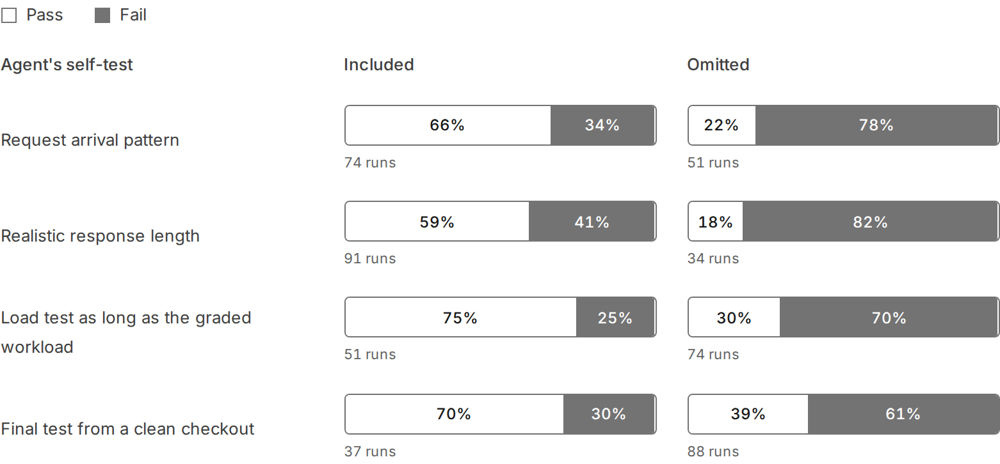</picture>

***Figure 11. Pass rate by test coverage.** Pass rates for 125 graded main-evaluation runs, grouped by whether the agent's self-test covered each condition. A self-test uses realistic response lengths when it lets the server generate full responses without cutting them short.*

### Finding 3: In most failed runs, agents had already encountered the same or a related error, but left the underlying problem unresolved.

In 85% of the 65 failed main-evaluation runs, development logs had already shown the same failure mechanism or a closely related one: incorrect outputs, hangs under load, or crashes on long inputs. For these runs, the held-out evaluation exposed a problem in a class the agent had already encountered.

In 78% of these 65 failed runs, the agent's first response was to dismiss the anomaly or patch only the site where it appeared; 5% investigated the cause and checked related sites ([Figure 12](#figure-failures)). The remaining 17% had no recorded related warning, insufficient evidence to classify the warning, or an unclassified response. With related warnings already present in most failed runs, more systematic debugging could improve reliability without access to held-out tests. A harness could require agents to diagnose each observed anomaly and verify the fix with regression tests covering related inputs, code paths, and concurrent sessions.

<picture><source media="(max-width: 600px)" srcset="/assets/img/blog/2026-11-20-introducing-hls/failures-narrow.png">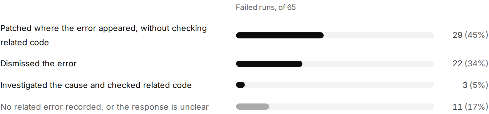</picture>

***Figure 12. Responses to early warnings in failed runs.** The 65 main-evaluation runs that failed final evaluation, by the agent's first response when its own tests showed an error with the same failure mechanism as the final failure, or a closely related one. Checking related code means looking for the same failure mechanism in other code paths that use the affected logic. The gray bar holds the runs with no such error recorded and those whose evidence or response could not be classified.*

### Finding 4: Weaker agents stop attempting to make progress early despite being put in a Ralph loop.

Several Opus 4.8 speech runs declared a hardware limit after three to four hours and idled for six to eight hours with correct servers, while Opus 5 found further 10–30% gains on the same tasks. Across passing runs, optimizations kept after hour four (speculation, batching, graph sizes, chunking, and kernel fusion) yielded median gains of 6–13% in agents' tests. Checking hardware-limit claims against profiles and untested alternatives could turn idle time into further improvements.

GPT 5.5 averaged 10% idle time, nearly half of it from one omni run that committed after about half an hour and slept for over eleven hours to exhaust its budget. The harness kept the run alive after engineering stopped. A stopping rule based on remaining experiments could make better use of that time.

## Conclusion

HLS shows that agents can build hyperspecialized inference systems that outperform production engines, while correctness and performance remain unreliable across attempts and deployments. The difficulty extends beyond implementing fast kernels: agents must choose a serving architecture, preserve model behavior across interacting components, and measure the system under realistic traffic.

If you're using agents to help build hyperspecialized inference stacks today, we recommend

- **Testing under representative workloads.** Tests that reproduce deployment conditions could surface failures earlier and give agents better feedback on which optimizations help. Realistic, high concurrency test conditions not only ensures that the agent built system performs well for you intended workload but also help surface correctness issues.
- **Encouraging profiling-driven decisions in architectural design.** Measuring alternatives before committing to a design could save hours spent tuning a poor starting point.
- **Proper and in-depth diagnosis of faults.** Faults that occur under specific conditions and loads should be investigated and reproduced instead of brushed over. Investigating the root cause of an error, scanning for issues of the same failure mode, and testing related sites could prevent the same failure from recurring in the final evaluation.

The released evaluation framework and trajectories make it possible to test how these interventions affect the systems agents build and how they build them.

---

*This post is also published at [hlsbench.com](https://hlsbench.com/blog/introducing-hls).*
